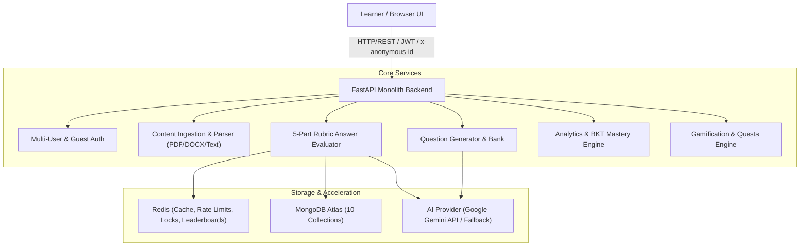

# High-Level Design (HLD) — SkillArena AI

## 1. System Overview
SkillArena AI is an AI-powered interview preparation and adaptive learning platform. It allows candidates and learners to supply topics, notes, or resume blueprints, generates grounded interview questions across multiple formats (descriptive, scenario, technical, MCQ), performs 5-part rubric evaluation, and adapts difficulty based on Bayesian Knowledge Tracing (BKT) and Exponential Moving Averages (EMA).

## 2. Security Architecture
- **JWT & Password Security**: SHA-256 / Bcrypt salted password hashing, JWT bearer tokens with expiration.
- **Anonymous Session Continuity**: Multi-tenant isolation for guest users via `x-anonymous-id` with smooth upgrade path to full user accounts.
- **Rate Limiting**: Sliding window counter (60 req/min) enforced per user/IP using Redis with in-memory fallback.
- **Input Validation**: Strict Pydantic models, 10MB upload limits, and MIME verification for documents.
